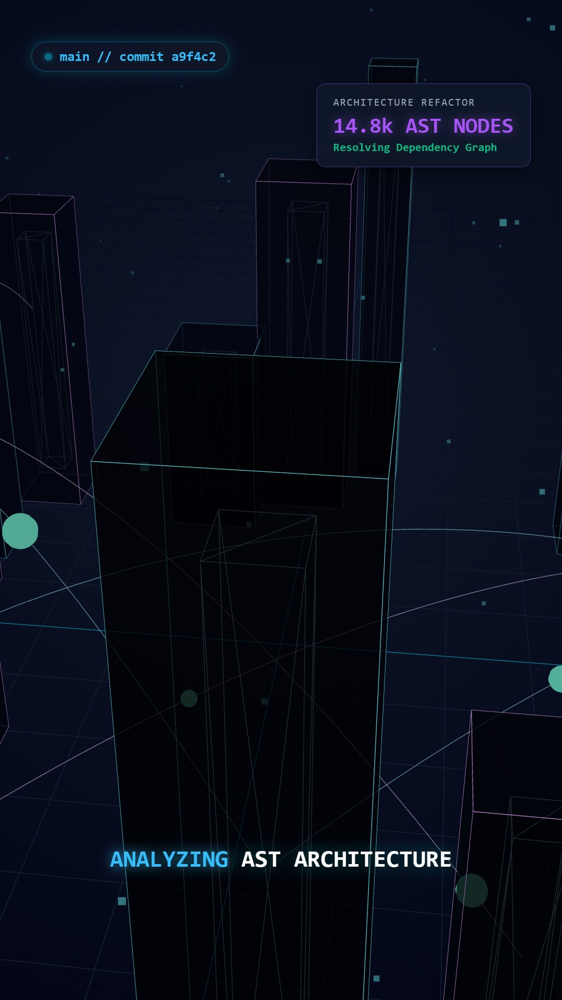

# ⚡ CodeCinematics — Git & Codebase to 3D Cyberpunk Vertical Explainer Reel Engine

> **The World's First Code-to-Cinema Engine for AI Agents.** Transform any Git repository, commit diff, or software architecture into viral 3D cyberpunk motion graphics reels (9:16 vertical, 1080x1920) in pure Three.js code.

<p align="center">
  
</p>

<p align="center">
  <a href="https://opensource.org/licenses/MIT"></a>
  <a href="#"></a>
  <a href="#"></a>
  <a href="#"></a>
  <a href="#"></a>
</p>

---

## 🌟 The Breakthrough Concept

Traditional code changelogs and release notes are boring markdown lists that developers skim. **CodeCinematics** is a studio-grade AI skill that turns any codebase into a **living 3D Cybernetic City**:

* **Files become Holographic Towers**: Glass skyscrapers whose heights represent Lines of Code (LOC) and complexity.
* **Function Calls become Laser Highways**: Spline curves pulse high-speed data packets between architectural modules.
* **Git Diffs become Particle Detonations**:
  * Emerald Green (`+`) shockwaves construct new crystalline structures block by block.
  * Crimson Red (`-`) digital disintegration vaporizes obsolete legacy code.
* **Floating Cyber HUD**: Live telemetry tracking AST complexity, commit hashes, latency benchmarks (`142ms -> 18ms (-87%)`), and kinetic monospace subtitles.

---

## 📸 Generated Reel Anatomy

<p align="center">
  
</p>

| Telemetry HUD | 3D Code Skyscrapers | Fiber-Optic Splines | Kinetic Subtitles |
|:---:|:---:|:---:|:---:|
| Live commit hash & AST node metrics | Volumetric glass towers with glowing internal cores | Quadratic bezier highways with moving data packets | Terminal monospace text with drop-shadow glow |

---

## 🚀 Quickstart

### 1. Installation
Clone into your AI agent's skills directory:
```bash
git clone https://github.com/atharvabalujadhav21052007-ux/code-cinematics.git
```

### 2. Analyze Your Codebase
Run the AST analyzer to extract your architecture and diff metrics into a 3D manifest:
```bash
python engine/git_ast_analyzer.py --repo . --since "HEAD~5"
```

### 3. Render 1080x1920 Master Reel
Render high-speed deterministic frames via Playwright Chromium:
```bash
cd engine
pip install playwright
playwright install chromium
python render_cinematic.py
```

---

## 📐 Architecture

```
code-cinematics/
├── SKILL.md                  # AI Agent Skill instructions (Antigravity / Claude / Cursor)
├── README.md                 # Visual documentation & quickstart
├── LICENSE                   # MIT License
├── docs/images/              # 3D stage visual showcase
└── engine/
    ├── index.html            # 9:16 vertical WebGL cybernetic stage
    ├── src/
    │   └── cyber_stage.js    # Three.js towers, laser splines, matrix rain & HUD
    ├── git_ast_analyzer.py   # Git commit diff & AST complexity parser
    └── render_cinematic.py   # Headless GPU frame capturer & FFmpeg multiplexer
```

---

## 📄 License
MIT © 2026 [Atharva Jadhav](https://github.com/atharvabalujadhav21052007-ux)
